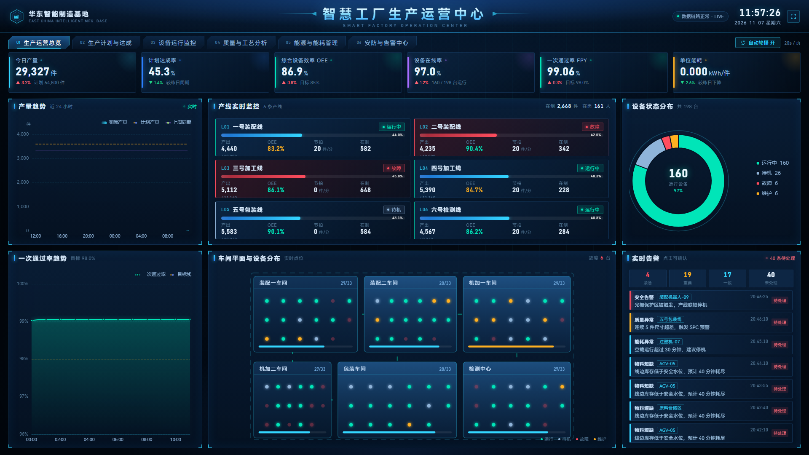
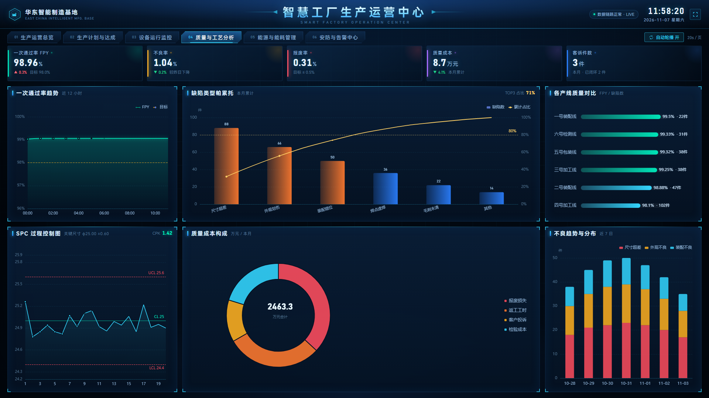

# 智慧工厂数据可视化大屏（前后端一体）

通用综合型工厂大屏，**前端 Vue 3 + Vite + ECharts，后端 Node.js + Express + WebSocket + SQLite**，真实联调、可持久化、可多屏同步。1920×1080 等比缩放，开箱即演示。

## 界面预览（1920×1080 实机截图）

| 01 生产运营总览 | 04 质量与工艺分析 |
| --- | --- |
|  |  |

> 共 6 屏（总览 / 计划达成 / 设备监控 / 质量工艺 / 能耗 / 告警），支持自动轮播。

```
现场设备(模拟) → 采集器(1s) → 内存实时态 ─┬─→ WebSocket 每 2s 推送大屏
                                          └─→ 每 10s 抽样落库（SQLite）
REST API(36 个端点) ←──── 大屏首屏一次聚合请求，翻页/筛选/写操作走真实接口
```

## 快速开始

```bash
npm install

npm run dev:all   # 一键启动前端(5178) + 后端(8080)，推荐
# 或分终端：
npm run server    # 仅后端，http://127.0.0.1:8080/api 可查看端点索引
npm run dev       # 仅前端，http://localhost:5178
```

联调自检（23 项断言，覆盖 REST / 分页 / 状态机 / WS 广播）：

```bash
node scripts/smoke-test.mjs   # 后端需已启动，输出 ALL PASSED 即通过
```

首次启动后端会自动建表并回填 7 天历史时序与告警数据（`server/data/factory.db`），删除该文件即可重置演示数据。

## 页面一览（6 屏，支持自动轮播）

| 路由 | 页面 | 数据来源 |
| --- | --- | --- |
| `#/overview` | 生产运营总览 | 快照 + WS tick |
| `#/production` | 生产计划与达成 | 快照 + `/api/production/*` |
| `#/equipment` | 设备运行监控 | 快照 + `/api/equipment/*` |
| `#/quality` | 质量与工艺分析 | 快照 + `/api/quality/*` |
| `#/energy` | 能源与能耗管理 | 快照 + `/api/energy/*`（真实 SQL 聚合） |
| `#/alarm` | 安防与告警中心 | **分页筛选 + PATCH 状态流转 + WS 多屏同步** |

## 前后端职责

```
src/
├── services/api.js        # 前端唯一数据出口：REST + WS + 指数退避重连 + 自动降级 mock
├── services/mock.js       # 降级兜底数据（结构 = 后端快照）
├── layout/ScreenLayout.vue# 缩放/轮播骨架
├── views/                 # 6 个页面
└── components/            # PanelBox / KpiCard / ChartBox / LineBoard / WorkshopMap / AlarmFeed…

server/
├── index.js               # 入口：HTTP + WS + 优雅退出
├── config.js              # 端口/采集周期/推送周期等集中配置
├── db/index.js            # SQLite（node:sqlite 内置，无需编译）+ 建表 + 事务
├── db/seed.js             # 主数据种子：6 产线 / 198 设备 / 工单 / 告警 / 7 天时序
├── realtime/state.js      # 内存实时态 + 秒级采集模拟（换成 OPC-UA/MQTT 即接真实设备）
├── realtime/collector.js  # 调度：1s 采集 / 2s 推送 / 10s 落库 / 15s 告警巡检
├── realtime/hub.js        # WS Hub：心跳、订阅、广播、多屏同步
├── services/              # 业务查询层（SQL 聚合都在这）
├── routes/                # 路由层（只做参数校验与响应包装）
└── utils/http.js          # 统一响应体 / 业务异常 / 分页 / 错误中间件
```

## 数据对接模式

通过项目根目录 `.env`（参考 `.env.example`）切换：

```ini
VITE_DATA_MODE=auto   # auto=优先后端、失败降级 mock（推荐）；http=强制后端；mock=纯前端演示
```

- **开发**：Vite 把 `/api` 与 `/ws` 代理到 127.0.0.1:8080；
- **生产**：Nginx 承担同样转发，前端构建产物 + 后端进程即可部署（后端也内置了 `dist` 托管）；
- **真实 MES/PLC 接入**：只需替换 `server/realtime/state.js` 的 `tickState()` 与 `services/` 中的查询，前端零改动。

## 接口文档

完整请求/响应、字段说明、WebSocket 协议、状态机图见 **[docs/api.md](docs/api.md)**。

关键契约：

- REST 统一响应 `{ code, message, data, ts }`，`code === 0` 为成功；
- 分页统一 `{ list, total, page, pageSize }`；
- 告警状态机 `open → ack → closed`，`closed` 终态，非法流转返回 409；
- WS 帧 `{ type, data }`，type ∈ `hello / tick / alarm / alarm:update / pong`。

## 大屏功能

- 全屏按钮 / F11；自动轮播 20s 一页（导航右侧开关）；
- 1920×1080 等比缩放居中，任意分辨率不变形；
- 顶部链路状态灯：**LIVE**（实时）/ 重连中 / 离线缓存，值班人员一眼判断数据真实性；
- 告警可确认/闭环，多块大屏操作实时同步。

## 自定义

- 换工厂名/标题：`components/ScreenHeader.vue`；
- 主题色：`styles/variables.css` + `charts/theme.js`；
- 采集/推送/落库频率：`server/config.js`；
- 数据库重置：删除 `server/data/factory.db` 后重启后端。
